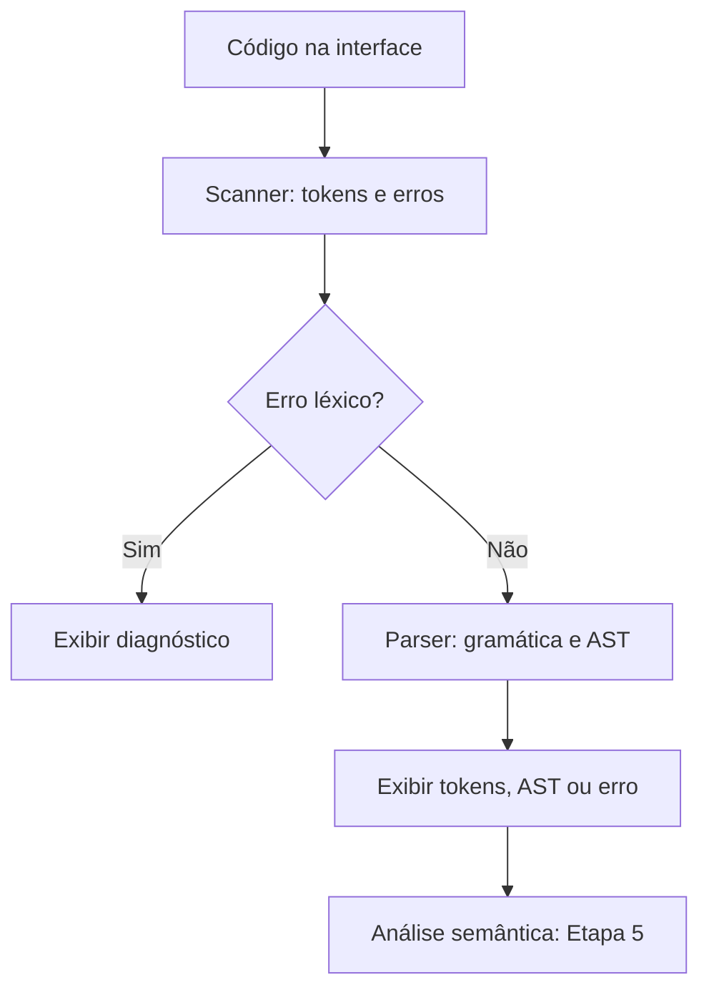

# Subsídios para Materiais e Métodos — Etapa 4

Texto de apoio para adaptar ao artigo, sem alegar resultados ainda não medidos.

## Procedimento

O CompilaRef usa Python e Flask no backend, HTML/CSS/JavaScript no frontend e
Docker Compose para executar os serviços. O scanner manual da Etapa 3 produz
tokens com tipo, lexema, linha e coluna. O parser descendente recursivo manual
interpreta esses tokens segundo a EBNF de `GRAMATICA.md`, consulta as linhas
originais para delimitar comandos e blocos indentados e produz nós de AST em
JSON. A interface mostra os tokens e a árvore hierárquica. Quando ocorre um
erro léxico, o parser não é executado; quando ocorre erro sintático, a resposta
contém a primeira posição e o elemento esperado.

## Critérios definidos antes da interpretação dos testes

| Critério | Evidência planejada |
|---|---|
| Reconhecimento | Atribuições, if/else, while e blocos aninhados válidos |
| Precedência | `10 + 5 * 2`, `20 - 5 - 3`, `(10 + 5) * 2` |
| Diagnóstico | Operando, `:`, `)`, bloco e `else` faltantes ou indevidos |
| Posições | Linha e coluna de tokens, nós e primeiro erro |
| Compatibilidade | Testes de scanner, API anterior e interface anterior |
| Ambiente | Build, serviços e comunicação via Docker Compose |

Os resultados efetivamente obtidos e as validações pendentes constam em
`REGISTRO_TESTES.md`. Uma comparação com artigos sobre parsers e visualização
de árvores requer leitura e citação individual das fontes antes de afirmar
qualquer lacuna ou diferencial frente à literatura.
